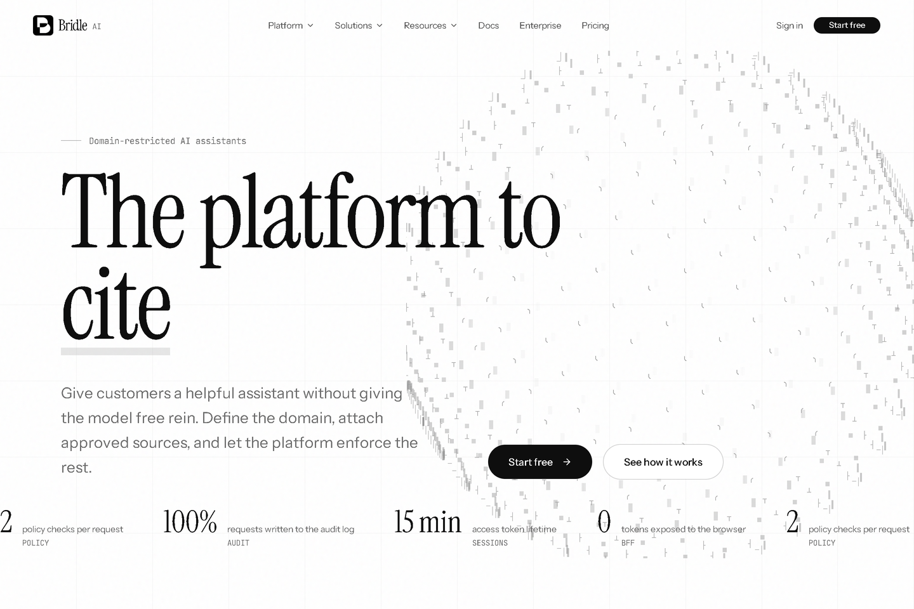
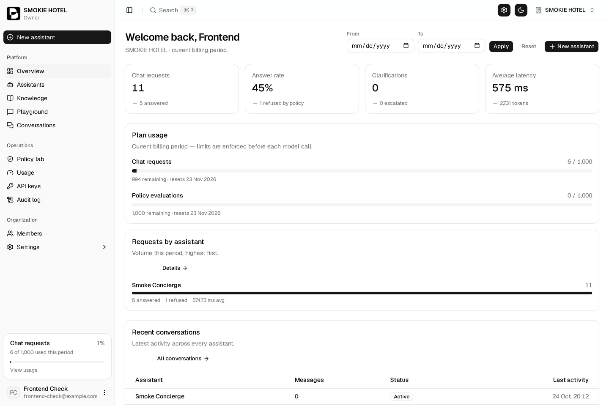
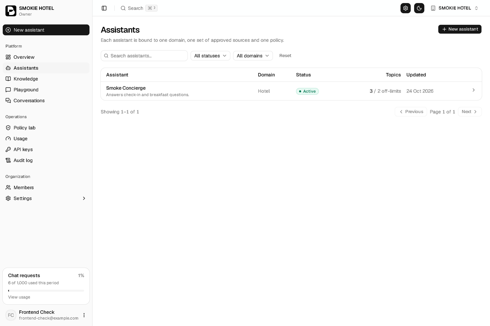
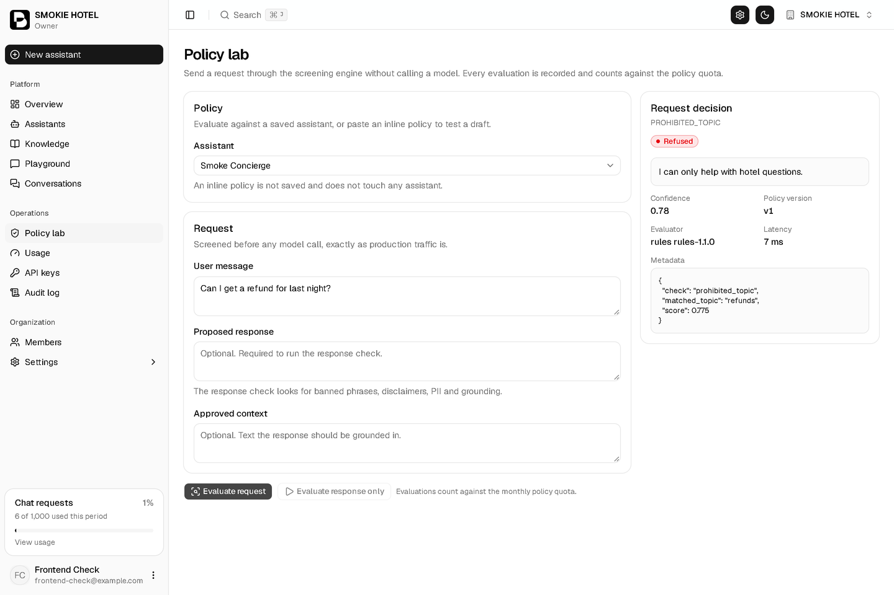
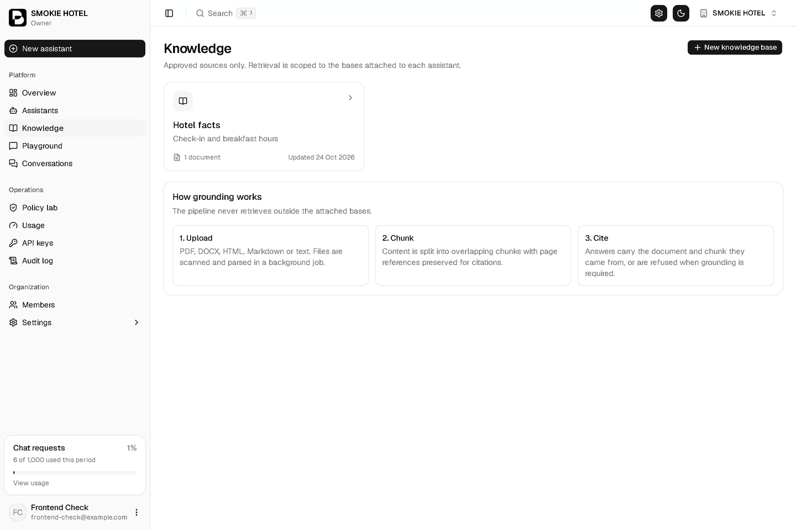
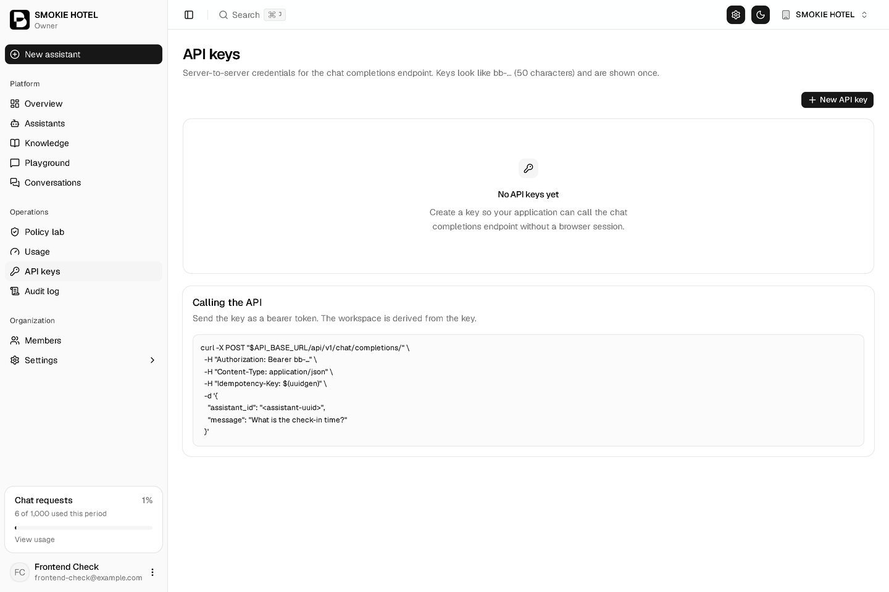
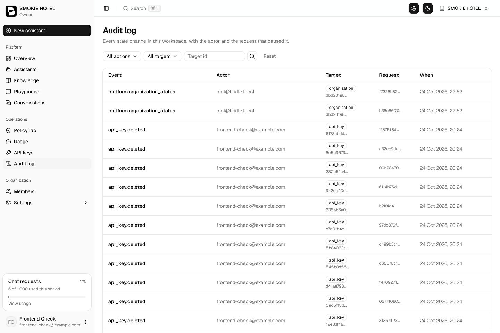
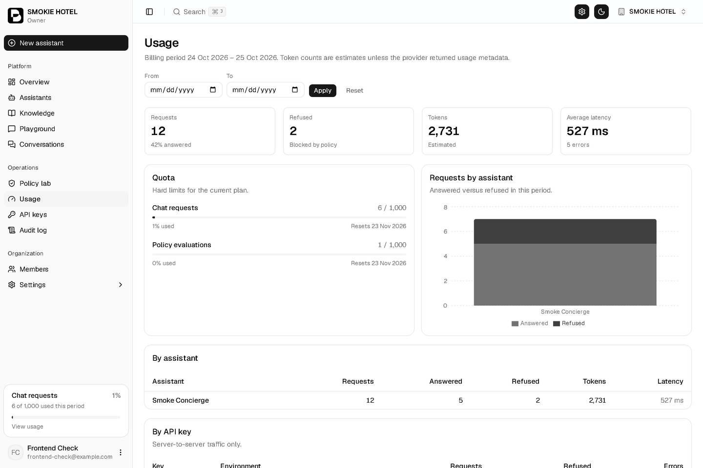
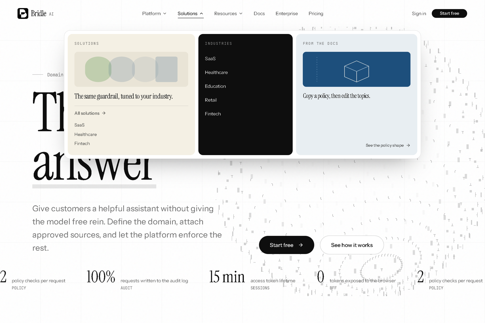

# Bridle AI — Console

**A control surface for domain-restricted AI assistants.** Define what an assistant may
answer, attach the sources it is allowed to cite, and get a decision — allow, refuse,
clarify or escalate — for every single request, with an audit trail to prove it.

Built with Next.js 16, React 19 and Tailwind CSS v4. Talks to the Bridle API
([Bridle-Backend](https://github.com/devpayoub/Bridle-Backend)) through a server-side BFF;
the browser never holds a provider key.



---

## Why it exists

Most assistants are easy to demo and hard to put in front of customers. The failure mode is
always the same: the model answers something it should not, and nobody can reconstruct why.

Bridle answers that with three things a support or compliance team can actually use:

- **A policy that runs before the model.** Topics, thresholds and refusal copy are
  configuration, not prompt engineering.
- **Answers with a source.** Retrieval is limited to the knowledge you attach, and every
  answer carries the document and chunk it came from.
- **A decision log.** Policy version, evaluator version, reason code, latency and tokens
  are recorded per request.

---

## Screens

### Overview — what happened, and why

Usage against plan, answer rate, latency and the busiest assistants, all in one view.



### Assistants — the domain, in plain language

Each assistant carries its domain, allowed and prohibited topics, system instructions and
the knowledge it may cite. The model is chosen per assistant.



### Policy lab — test the refusal before it matters

Send a request through the screening engine without spending a token. You get the decision,
the reason code, the matched topic and the confidence behind it.



### Knowledge — approved sources only

Upload documents, watch ingestion, and see exactly what the assistant can retrieve from.



### API keys — server-to-server access

Keys are `bb-` followed by 47 characters. Shown once, stored hashed, revocable, rotatable,
and scoped.



### Audit trail — every action, attributed

Role changes, policy edits, key rotations and assistant status changes, with actor and
request id.



### Usage — quota before it becomes a surprise

Requests and tokens per assistant and per key, with the plan limit enforced *before* the
model is called.



### Marketing site — the same design language

A full landing site with a mega menu and sixteen content pages, built on the same tokens as
the console.



---

## Capabilities

| Area | What you get |
| --- | --- |
| **Policy engine** | Allowed / prohibited topics, escalation keywords, allow & clarify thresholds, response constraints, versioned per assistant |
| **Grounding** | Per-assistant knowledge bases, chunk-level citations, refusal when nothing is found |
| **Conversations** | Threaded history, anonymisation, per-message decisions |
| **Keys** | `bb-` keys with scopes, rotation, revocation and two-step deletion |
| **Usage** | Quota per workspace, breakdowns per assistant and per key |
| **Audit** | Append-only event log with actor, target, metadata and request id |
| **Tenancy** | Role-based access (Owner → Read-only), workspace switching, capability-gated navigation |
| **Theme** | Light/dark, several presets, applied before first paint (no flash) |

---

## Tech stack

| | |
| --- | --- |
| Framework | Next.js 16 (App Router, React Compiler) |
| UI | React 19, Tailwind CSS v4, shadcn/ui (`radix-nova`) |
| Data | TanStack Query, TanStack Table |
| Forms | React Hook Form + Zod |
| Charts | Recharts |
| Icons | Lucide |
| Quality | TypeScript strict, Biome (lint + format + import order) |

---

## Getting started

**Requirements:** Node 20+, and the Bridle API running (see
[Bridle-Backend](https://github.com/devpayoub/Bridle-Backend)).

```bash
git clone https://github.com/devpayoub/Bridle-Frontend.git
cd Bridle-Frontend
npm install
cp .env.example .env.local     # point API_BASE_URL at your backend
npm run dev
```

Open <http://localhost:3000> and sign in, or create an account.

```bash
npm run dev      # development server
npm run build    # production build
npm run start    # serve the build
npm run check    # biome: lint, format, import order
npm run check:fix
```

### Environment

| Variable | Example | Purpose |
| --- | --- | --- |
| `APP_URL` | `http://localhost:3000` | Canonical origin (metadata, links) |
| `API_BASE_URL` | `http://localhost:8000` | The Bridle API |

> There is deliberately **no** `NEXT_PUBLIC_*` API URL. Every request is proxied through
> `src/app/api`, which attaches the session cookie server-side. A provider or platform key
> never reaches the browser.

---

## Project structure

```
src/
├── app/
│   ├── (external)/        marketing site — landing, mega menu, 16 content pages
│   ├── (main)/
│   │   ├── auth/          sign in, sign up, password reset, email verification
│   │   ├── onboarding/    create the first workspace
│   │   └── dashboard/     the console: overview, assistants, knowledge, policy lab,
│   │                      conversations, usage, keys, audit, members, settings
│   └── api/               BFF routes — auth, workspace switching, proxied resources
├── components/
│   ├── ui/                63 primitives (button, table, dialog, sidebar, chart …)
│   └── layout/            shell: header, sidebar, breadcrumbs, page header
├── lib/                   api client, server fetch, session, formatting, env
├── navigation/            sidebar and breadcrumb definitions
└── styles/                design tokens and theme presets
```

---

## Design system

- **Tokens as CSS variables** — a theme change is a variable change, not a component change.
- **Presets are generated** from `src/scripts/generate-theme-presets.ts`.
- **Dark mode** is class-based and applied by `src/scripts/theme-boot.tsx` before paint.
- **The marketing site is isolated** under `[data-landing-page]` with its own type scale, so
  the console never pays for landing fonts.

---

## Deployment

Any Node host works. On Vercel, set `APP_URL` and `API_BASE_URL` in the project settings and
deploy — no build-time secrets are required.

Behind a proxy, keep `APP_URL` equal to the public origin so session cookies and redirects
stay on the same host.

---

## Credits and license

The console is built on [Studio Admin](https://github.com/arhamkhnz/next-shadcn-admin-dashboard)
by Mohammed Arham Khan, released under the MIT license — see [LICENSE](LICENSE), which is
retained as required.

Product design, application code and content © Bridle AI.
